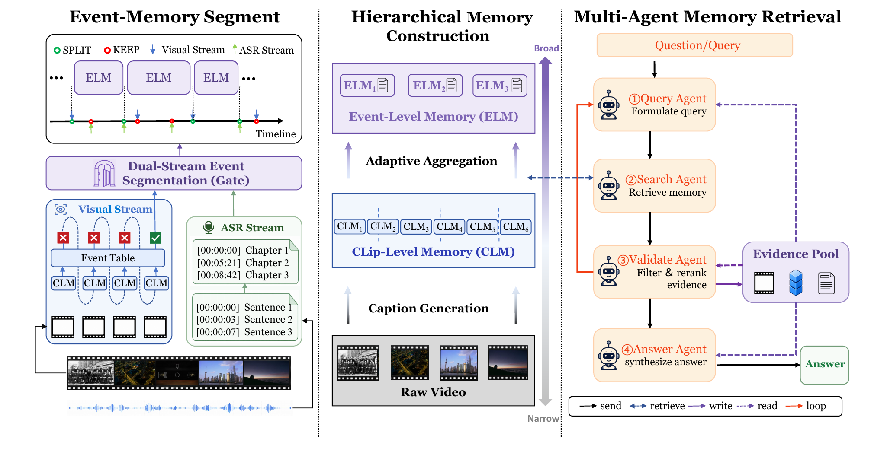

<h1 align="center">EMMA</h1>

<p align="center">
  <strong>Event-Driven Multimodal Memory System with Multi-Agent Retrieval</strong>
</p>

<p align="center">
  <a href="#quick-start">Quick start</a> ·
  <a href="#build-event-driven-memory">Build memory</a> ·
  <a href="#run-question-answering">Run question answering</a> ·
  <a href="#paper">Paper</a>
</p>

<p align="center">
  
</p>

EMMA is an event-driven memory system for answering questions about long videos.
It transforms video and speech into a hierarchy of short-term, medium-term, and
event memories, then uses grounded, multi-round retrieval to locate evidence
before producing an answer.

## Paper

Read the accompanying paper: [EMMA.pdf](assets/EMMA.pdf).

## Quick start

### 1. Clone the repository

```bash
git clone https://github.com/BAI-LAB/EMMA.git
cd EMMA
```

### 2. Create the environment

EMMA requires Python 3.10+, `ffmpeg`, and a CUDA-capable environment suitable
for the local vision-language model you choose. Install a compatible PyTorch
build first, then install the remaining dependencies:

```bash
pip install -r requirements.txt
```

Prepare the local ASR and vision-language model checkpoints separately; they
are not included in this repository. The ASR checkpoint must be in a
faster-whisper/CTranslate2-compatible format. To convert a Hugging Face Whisper
checkpoint once:

```bash
ct2-transformers-converter \
  --model /path/to/whisper-checkpoint \
  --output_dir /path/to/whisper-ct2 \
  --quantization float16 \
  --copy_files tokenizer.json preprocessor_config.json
```

### 3. Configure credentials and endpoints

Copy the example files and fill in your API credentials, OpenAI-compatible
endpoints, and model settings. Do not commit the resulting `.env` files.

```bash
cp memory/.env.example memory/.env
cp KQA/project/.env.example KQA/project/.env
```

On Windows PowerShell, use:

```powershell
Copy-Item memory/.env.example memory/.env
Copy-Item KQA/project/.env.example KQA/project/.env
```

## Build event-driven memory

Run the memory builder on a directory of videos. It transcribes audio, builds
short- and medium-term memories, and creates an event table. The local
vision-language model remains available across videos, so its startup cost is
reported separately from steady-state per-video processing time.

```bash
python memory/run_memory.py \
  --input-dir /path/to/videos \
  --output-root /path/to/memory-results \
  --asr-model-dir /path/to/whisper-ct2 \
  --qwen-model /path/to/vision-language-model \
  --device-id 0 \
  --fail-fast
```

For a reproducible subset, create a text file containing one absolute video
path (or video filename) per line and add `--video-list /path/to/list.txt`.
Use `--rerun-asr` to measure ASR again instead of reusing existing transcripts.

Each processed video creates the following output tree:

```text
{output_root}/{video_name}/outputs/
├── asr_segments.json
├── chapter_segmentation.json
├── short_term.json
├── medium_term.json
└── event_table.json
```

Run-level timing reports are saved under
`{output_root}/_runs/<timestamp>/summary.json` and `per_video_timings.json`.

## Run question answering

Point the KQA runner to the Stage 1 memory results, raw videos, and a benchmark
question file. The runner processes questions sequentially and starts a local
vision-language server only when raw-video evidence is needed.

```bash
python KQA/project/run_batch.py \
  --videomme-json /path/to/videomme.json \
  --results-root /path/to/memory-results \
  --raw-video-root /path/to/videos \
  --qwen-model /path/to/vision-language-model \
  --device-id 0
```

Use `--question-id <id>` or `--max-questions 1` for a smoke test. Results,
retrieval traces, errors, and a timing summary are written to
`KQA/project/outputs/batch_<timestamp>/` unless `--out-root` is provided.

## Retrieval workflow

EMMA follows a grounded coarse-to-fine route:

1. Localize likely events in medium-term memory.
2. Retrieve short-term memory evidence for the candidate moments.
3. Escalate to raw video when the memory evidence is insufficient.
4. Stop as soon as the retrieved evidence supports a reliable answer.

After repeated stalled rounds, the system automatically escalates from
medium-term memory to short-term memory and then raw-video evidence. A
closest-candidate fallback keeps retrieval grounded when no direct evidence is
found.

## Repository layout

```text
EMMA/
├── assets/                    # README and paper assets
├── memory/                    # ASR and event-driven memory construction
│   ├── run_memory.py           # Stage 1 entry point
│   └── .env.example
├── KQA/project/                # Multi-agent question answering
│   ├── run_batch.py            # Stage 2 entry point
│   ├── configs/                # Runtime configurations
│   └── .env.example
├── qwen_vl_utils.py
├── requirements.txt
└── LICENSE
```

## Notes

- `.env` files, datasets, model checkpoints, generated outputs, and logs are
  ignored by Git. Review `git status` before every public push.
- The supplied memory runner releases the ASR model before starting the local
  vision-language server to reduce model residency pressure.
